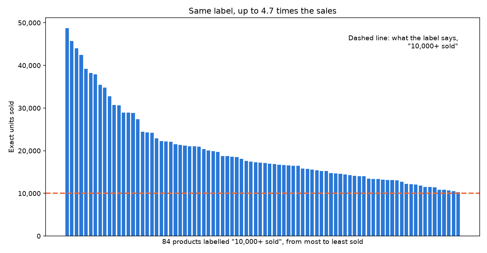
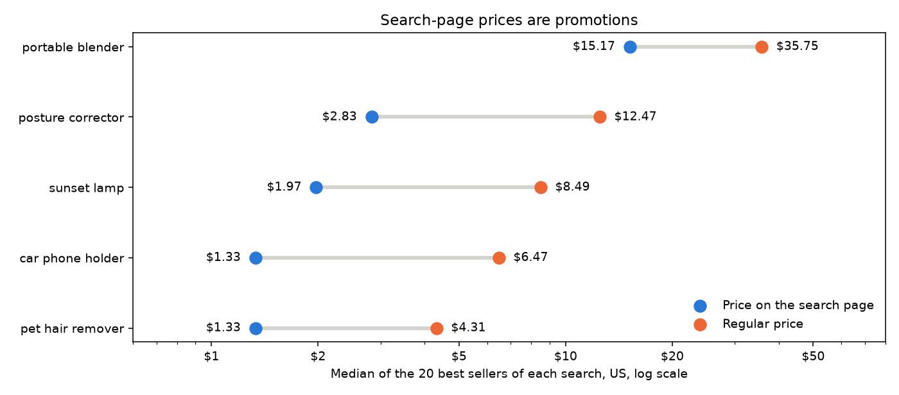

# How to Find Best-Selling Products on AliExpress with Exact Sales Numbers

*AliExpress tells you a product has "10,000+ sold" whether it sold 10,312 units or 48,751. Here is how to get the exact sold count, the regular price and the search position of every product in a search, compare product ideas in one table, and track them over time, with Python or without code.*

*This guide was written with the assistance of an AI writing tool. Every code sample in it was run against the live scraper before publishing, and every number comes from those runs on October 20, 2026.*

If you sell online, AliExpress is one of the best free demand signals there is. Dropshippers use it to test product ideas, Amazon and TikTok Shop sellers use it to see what is already moving, and brands use it to watch cheap copies of their products. The search page shows how many units each product has sold, and you can sort by orders.

But the website hides three things that matter when you compare products:

1. **The sold count is rounded.** "10,000+ sold" can mean 10,312 or 48,751.
2. **The price on the search page is often a promotion.** A car phone holder shown at $0.33 has a regular price of $5.88, and the promotional price changes from one visit to the next.
3. **You can't export a search.** Comparing five product ideas means scrolling through 600 cards and copying numbers by hand.

The [AliExpress Search Scraper](https://apify.com/robertosan16/aliexpress-search-scraper) on Apify reads AliExpress search pages and returns every product as a row: title, price on the search page, regular price, discount, the **exact** sold count from AliExpress's own counter, rating, Choice and ad labels, badges and the position in the results. No browser, no login.

## Option 1: No code

1. Open [AliExpress Search Scraper](https://apify.com/robertosan16/aliexpress-search-scraper) and click **Try for free**. The free Apify plan is enough for everything in this guide.
2. Enter your **search keywords**, one per line, or paste search and category links from AliExpress.
3. Choose **Sort by → Orders (best sellers first)** and the number of **products per search**, for example 120.
4. Pick the **Ship to** country. Prices, currency and delivery follow it.
5. Click **Start** and download the results as CSV, Excel or JSON.

## Option 2: Python, five product ideas in one table

Install the Apify client, pandas and matplotlib:

```bash
pip install apify-client pandas matplotlib
```

Copy your API token from Apify Console (Settings → API & Integrations) into the `APIFY_TOKEN` environment variable. This script takes the 120 best-selling products of five product ideas, shipped to the United States, and scores each idea:

```python
import os
import pandas as pd
from apify_client import ApifyClient
client = ApifyClient(os.environ["APIFY_TOKEN"])
ideas = ["portable blender", "pet hair remover", "car phone holder", "posture corrector", "sunset lamp"]
run = client.actor("robertosan16/aliexpress-search-scraper").call(run_input={
    "searchQueries": ideas,
    "sort": "orders",
    "maxItemsPerSearch": 120,
    "shipTo": "US",
}, logger=None)
df = pd.DataFrame(client.dataset(run.default_dataset_id).iterate_items())
df.to_json("products.json", orient="records")
top = df[df["position"] <= 20]
card = pd.DataFrame({
    "products": df.groupby("searchQuery").size(),
    "sold_1000_plus": df[df["soldCount"] >= 1000].groupby("searchQuery").size(),
    "top_seller_sold": df.groupby("searchQuery")["soldCount"].max(),
    "median_price_top20": top.groupby("searchQuery")["price"].median(),
    "median_rating_top20": top.groupby("searchQuery")["rating"].median(),
    "choice_share_top20": top.groupby("searchQuery")["isChoice"].mean().round(2),
}).fillna(0).astype({"sold_1000_plus": int})
print(card.sort_values("sold_1000_plus", ascending=False).to_string())
```

The run took 36 seconds and returned 600 products. The output:

```
                   products  sold_1000_plus  top_seller_sold  median_price_top20  median_rating_top20  choice_share_top20
searchQuery
car phone holder        120             120           162169               1.330                 4.90                0.95
pet hair remover        120             107            61592               1.330                 4.90                0.85
sunset lamp             120              33            82930               1.975                 4.70                1.00
posture corrector       120              25            35424               2.830                 4.45                0.95
portable blender        120              10             6429              15.170                 4.90                0.85
```

Five product ideas, five very different markets:

- **Car phone holders** are a proven, crowded market: all 120 of the best sellers have sold more than 1,000 units, and the top one 162,169.
- **Pet hair removers** are close behind: 107 of 120 above 1,000 sold.
- **Sunset lamps** have a few big winners (the top one sold 82,930) and a long tail: only 33 products above 1,000.
- **Posture correctors** have the lowest ratings of the five, a median of 4.45 among the top 20.
- **Portable blenders** sell far fewer units, only 10 above 1,000, but at a much higher price per unit.

The table doesn't tell you which idea to pick. It tells you how deep the demand is and how hard the competition will be, in numbers you can sort, instead of an impression from scrolling.

## Why "10,000+ sold" is not enough

AliExpress rounds the sold label down to a round number. The scraper reads the exact count from the same card, so you can see what each label hides:

```python
import pandas as pd
df = pd.read_json("products.json")
labels = df.groupby("soldText")["soldCount"].agg(["count", "min", "max"])
print(labels.loc[["100K+ sold", "50,000+ sold", "10,000+ sold", "5,000+ sold", "1,000+ sold"]].to_string())
```

```
              count     min     max
soldText
100K+ sold        2  143367  162169
50,000+ sold      9   50654   86983
10,000+ sold     84   10312   48751
5,000+ sold      39    5003    9646
1,000+ sold      55    1012    1989
```

84 of the 600 products carry the same "10,000+ sold" label. The best of them sold 48,751 units, 4.7 times the weakest:



```python
import matplotlib.pyplot as plt
import pandas as pd
df = pd.read_json("products.json")
same = df[df["soldText"] == "10,000+ sold"].sort_values("soldCount", ascending=False)
fig, ax = plt.subplots(figsize=(10, 5.2))
ax.bar(range(len(same)), same["soldCount"], width=0.75, color="#2a78d6")
ax.axhline(10000, color="#eb6834", linewidth=2, linestyle="--")
ax.text(len(same) - 1, 44000, 'Dashed line: what the label says,\n"10,000+ sold"', ha="right")
ax.set_xticks([])
ax.set_ylabel("Exact units sold")
ax.yaxis.set_major_formatter(lambda value, _: f"{value:,.0f}")
ax.set_xlabel(f'{len(same)} products labelled "10,000+ sold", from most to least sold')
ax.set_title("Same label, up to 4.7 times the sales")
fig.tight_layout()
fig.savefig("sold-labels.png", dpi=140)
```

If you rank products by the label, these 84 tie. By the exact count, the top one has sold more than the bottom four combined.

## The price on the search page is a promotion

The second trap is the price. Among the 20 best sellers of each search, the median price on the search page is a fraction of the regular, crossed-out price:



```python
import matplotlib.pyplot as plt
import pandas as pd
df = pd.read_json("products.json")
top = df[df["position"] <= 20].groupby("searchQuery")[["price", "originalPrice"]].median().sort_values("originalPrice")
fig, ax = plt.subplots(figsize=(10, 4.4))
rows = range(len(top))
ax.hlines(rows, top["price"], top["originalPrice"], color="#d4d3cd", linewidth=3)
ax.scatter(top["price"], rows, s=90, color="#2a78d6", label="Price on the search page", zorder=3)
ax.scatter(top["originalPrice"], rows, s=90, color="#eb6834", label="Regular price", zorder=3)
for row, (price, regular) in enumerate(zip(top["price"], top["originalPrice"])):
    ax.text(price / 1.1, row, f"${price:.2f}", ha="right", va="center")
    ax.text(regular * 1.1, row, f"${regular:.2f}", ha="left", va="center")
ax.set_xscale("log")
ax.set_xlim(0.6, 80)
ax.set_xticks([1, 2, 5, 10, 20, 50], ["$1", "$2", "$5", "$10", "$20", "$50"])
ax.set_yticks(list(rows), top.index)
ax.set_xlabel("Median of the 20 best sellers of each search, US, log scale")
ax.set_title("Search-page prices are promotions")
ax.legend(loc="lower right", frameon=False)
fig.tight_layout()
fig.savefig("prices.png", dpi=140)
```

Two things make the search-page price a poor base for margin math:

- **It changes from visit to visit.** We ran two of the searches again four minutes later. Of 99 products found both times, 26 showed a different price on the search page: the top car phone holder went from $1.33 to $1.09, another from $0.33 to $1.09, another from $5.19 to $2.39. The regular price stayed the same for 94 of the 99.
- **It is often a first-order price.** Many cards carry a badge such as "New shoppers save $4", meaning the price shown is what a new customer pays on a first order. The scraper marks these products with `isNewShopperPrice: true`. Among portable blenders, two out of three had one.

For your margins, treat the search-page price as the best case and the regular price (`originalPrice`) as the safe upper bound.

## Track best sellers over time

One run is a snapshot. Run the same searches again later and compare, and you see which products are gaining sales, which changed their regular price and which moved up or down in the results. This script compares a new run with the `products.json` saved above:

```python
import os
import pandas as pd
from apify_client import ApifyClient
client = ApifyClient(os.environ["APIFY_TOKEN"])
run = client.actor("robertosan16/aliexpress-search-scraper").call(run_input={
    "searchQueries": ["car phone holder", "pet hair remover"],
    "sort": "orders",
    "maxItemsPerSearch": 60,
    "shipTo": "US",
}, logger=None)
now = pd.DataFrame(client.dataset(run.default_dataset_id).iterate_items())
before = pd.read_json("products.json", dtype={"productId": str})
both = now.merge(before, on=["productId", "searchQuery"], suffixes=("", "_before"))
hours = (pd.to_datetime(both["scrapedAt"]) - pd.to_datetime(both["scrapedAt_before"])).dt.total_seconds().mean() / 3600
print(f"{len(both)} products in both runs, {hours:.1f} hours apart")
for field in ["soldCount", "originalPrice", "price", "position"]:
    print(f"{field:14} changed for {(both[field] != both[field + '_before']).sum()}")
both["new_sales"] = both["soldCount"] - both["soldCount_before"]
print(both.sort_values("new_sales", ascending=False).head(5)[["searchQuery", "position", "soldCount", "new_sales"]].to_string(index=False))
```

__TRACK_OUTPUT__

To do this without code, save your input as a **task** in Apify Console and add a **schedule**, for example every Monday at 8:00. Then download each week's results, or connect Google Sheets in the task's **Integrations** tab, and compare the weeks in a spreadsheet.

## More filters

The same Actor takes a few more settings that are useful for product research:

```json
{
  "searchQueries": ["posture corrector"],
  "sort": "orders",
  "maxItemsPerSearch": 300,
  "shipTo": "US",
  "shipFrom": "US",
  "minPrice": 5,
  "maxPrice": 30,
  "minRating": 4.5,
  "minSold": 100,
  "skipSponsored": true
}
```

- `shipFrom` keeps only products from a local warehouse, such as the United States, Spain or Germany. In our runs, 671 of 4,480 posture correctors and 3,110 of 5,843 portable blenders shipped to the US from a US warehouse.
- `minSold` and `minRating` drop products below your bar. With sorting by orders, the search stops at the first page where every product is below `minSold`, so you don't pay for products you would throw away.
- `shipTo` and `currency` cover 51 countries. Prices, currency and delivery estimates follow the ship-to country.
- `startUrls` takes search and category links copied from AliExpress, with their filters.

## Good to know

- The scraper reads search and category pages, not product pages: no variants, descriptions or reviews.
- AliExpress shows at most 60 pages of 60 products for one search, 3,600 products. For more, split the search by price range or category.
- AliExpress sometimes mixes recommendations of other products into a results page. The scraper loads such pages again and saves only real search results, so positions and sorting stay right.
- Store names appear on some cards only, so `storeName` is often empty.

## What it costs

The Actor charges $1.50 per 1,000 products, with no start fee, and paid Apify plans get 10–30% off. The five-idea comparison above returned 600 products, $0.90. The monthly credit of the free Apify plan covers about 3,300 products.
