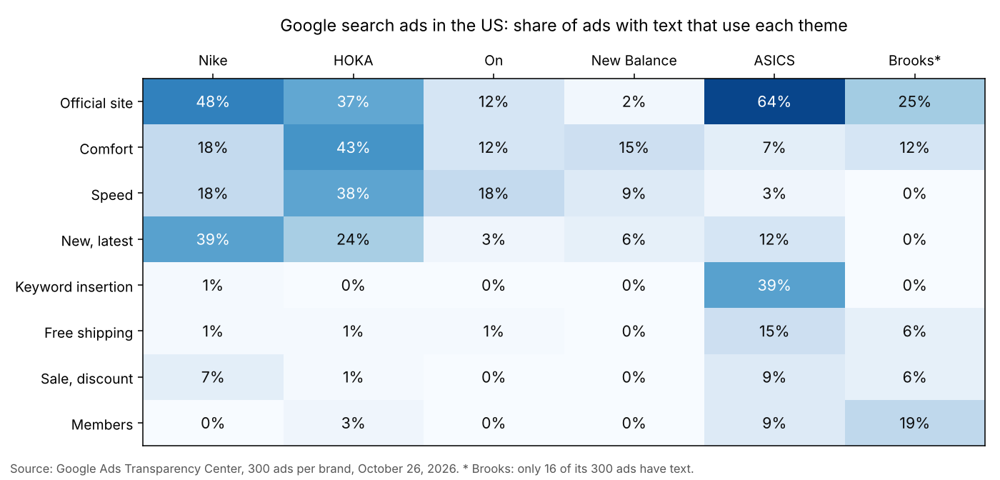

# How to See Every Google Ad Your Competitors Run, with the Ad Copy as Text

*Google shows every ad of every advertiser in its Ads Transparency Center, but only one ad at a time, often as a picture, and with no export. Here is how to get a competitor's ads as a table, with headline, description and dates, and what 1,800 search ads of six running-shoe brands show about their strategy.*

*This guide was written with the assistance of an AI writing tool. Every code sample in it was run against the live scraper before publishing, and every number comes from those runs on October 26, 2026.*

Your competitors' Google ads are public. Since 2023, Google has listed every ad of every advertiser in the [Ads Transparency Center](https://adstransparency.google.com/): search for a website or a company and you see their search, YouTube, Shopping and display ads, with the dates each one ran. For competitor research this is a gold mine, but the site is built for looking, not for analysis. You open ads one by one, there is no download button, and most text ads appear as a picture of the ad, which is why the usual advice is to run the screenshots through OCR.

The [Google Ads Transparency Scraper](https://apify.com/robertosan16/google-ads-transparency-scraper) on Apify reads the Transparency Center for you and returns one row per ad: advertiser, format, first and last date shown, and the ad copy as text (headline, description, display URL), read from the ad itself rather than from a picture. No browser, no OCR, no API key from Google.

## Option 1: No code

1. Open [Google Ads Transparency Scraper](https://apify.com/robertosan16/google-ads-transparency-scraper) and click **Try for free**.
2. In **Brands, websites or links**, enter your competitors' websites, one per line: `hoka.com`, `on.com`. A website returns every ad that points to it, from every advertiser account.
3. Set **Region** to the country you sell in, for example `US`, and in **Platforms** pick **Search** if you only want search ads.
4. Click **Start** and download the ads as CSV, Excel or JSON.

## Option 2: Python, six brands at once

Install the Apify client and pandas:

```bash
pip install apify-client pandas matplotlib
```

Copy your API token from Apify Console (Settings → API & Integrations) into the `APIFY_TOKEN` environment variable. This script takes the US search ads of six running-shoe brands, 300 per brand, and counts how many come with text:

```python
import os
import pandas as pd
from apify_client import ApifyClient
client = ApifyClient(os.environ["APIFY_TOKEN"])
brands = ["nike.com", "hoka.com", "on.com", "newbalance.com", "asics.com", "brooksrunning.com"]
run = client.actor("robertosan16/google-ads-transparency-scraper").call(run_input={
    "queries": brands,
    "region": "US",
    "platforms": ["SEARCH"],
    "maxAdsPerSearch": 300,
}, logger=None)
ads = pd.DataFrame(client.dataset(run.default_dataset_id).iterate_items())
ads.to_json("ads.json", orient="records")
ads["withText"] = ads["headline"].notna() | ads["description"].notna()
summary = ads.groupby("source").agg(ads=("creativeId", "count"), withText=("withText", "sum"), advertisers=("advertiserId", "nunique"))
print(summary.reindex(brands).to_string())
```

The run took 20 minutes and returned 1,800 ads, all of them shown between October 22 and 26:

```
                   ads  withText  advertisers
source                                       
nike.com           300       232            7
hoka.com           300       108            7
on.com             300       228            2
newbalance.com     300       231            6
asics.com          300       150            9
brooksrunning.com  300        16            3
```

For Nike, On and New Balance, three ads in four come with their copy. Brooks is the exception: Google keeps almost all of its ads only as pictures, so 16 of 300 have text. Those ads still have their dates and a link to the picture (`imageUrl`). Three hundred ads are a sample, not everything: the Transparency Center reports 7,000–8,000 ads for nike.com and 3,000–4,000 for hoka.com, and **Max ads per brand, website or advertiser** goes up to 10,000.

## The ads that run longest

An advertiser keeps paying for an ad that works and stops one that doesn't. So an ad that has been running for years is one of the best clues to what converts. Each ad comes with `firstShown`, `lastShown` and `shownForDays`; the two longest-running ads with text of each brand:

```python
import pandas as pd
ads = pd.read_json("ads.json")
ads["since"] = pd.to_datetime(ads["firstShown"]).dt.date
text_ads = ads[ads["headline"].notna()]
longest = text_ads.sort_values("shownForDays", ascending=False).groupby("source").head(2)
print(longest[["source", "shownForDays", "since", "headline"]].to_string(index=False))
```

```
           source  shownForDays      since                                                                         headline
        asics.com          1827 2021-10-25                                                   {KeyWord:ASICS® Running Shoes}
        asics.com          1826 2021-10-25                                 ASICS METASPEED RAY - White/Flash Red - Size 3.5
         nike.com          1788 2021-10-25                                                                    Site bezoeken
   newbalance.com          1677 2022-03-02                                                       Shop Our Tennis Collection
   newbalance.com          1677 2022-03-02                                                           New Balance Basketball
         nike.com          1175 2023-06-22                                                              Nike® Official Site
brooksrunning.com           574 2025-03-31                           Series | Ghost 18, Ghost Max 3 & More | Brooks Running
brooksrunning.com           404 2025-09-17 Brooks Running Men's Glycerin Max 2 Road Running Shoes, White/Black/Chateau Gray
         hoka.com           277 2026-01-22                                                         Shop Men's Running Shoes
         hoka.com           277 2026-01-22                                                    Road, Trail, Hiking, Fitness.
           on.com           222 2026-03-18            On Cyclon | Cloudnova | Men's | Size: 9 | Color: Undyed-White / White
           on.com           210 2026-03-27                                                             On® - Official Store
```

Two strategies show up. ASICS, Nike and New Balance keep evergreen ads for years: ASICS's `{KeyWord:ASICS® Running Shoes}` has run since at least October 25, 2021, the earliest date in the data (19 ads share it, which looks like the limit of the Transparency Center). HOKA and On rotate: the typical HOKA ad in the sample has run for 46 days and the typical On ad for 167, against 830 for New Balance and 894 for Nike. (`Site bezoeken` is Dutch for "Visit site". That Nike ad runs in 34 countries, the US among them, and Google keeps one language version of it.)

## What each brand says

With the copy as text, you can measure what a brand talks about. This snippet checks each ad's headline and description for eight common themes and gives the share of each brand's ads that use them:

```python
import pandas as pd
brands = ["nike.com", "hoka.com", "on.com", "newbalance.com", "asics.com", "brooksrunning.com"]
themes = {
    "Official site": r"official",
    "Comfort": r"comfort|cushion|soft",
    "Speed": r"performance|\bfast|speed|\brace|record|propel",
    "New, latest": r"\bnew\b|latest|newest",
    "Keyword insertion": r"\{keyword:",
    "Free shipping": r"free (?:shipping|returns|delivery|standard)",
    "Sale, discount": r"\bsale\b|% off|discount|\bdeals?\b|clearance|\bsave\b|outlet",
    "Members": r"member|rewards|\bjoin\b",
}
ads = pd.read_json("ads.json")
copy = ads[ads["headline"].notna() | ads["description"].notna()].copy()
copy["text"] = (copy["headline"].fillna("") + " " + copy["description"].fillna("")).str.lower()
copy["text"] = copy["text"].str.replace("new balance", "nb")  # the brand name is not a "new" claim
share = pd.DataFrame({name: copy.groupby("source")["text"].apply(lambda s, p=pattern: s.str.contains(p).mean() * 100) for name, pattern in themes.items()})
share = share.reindex(brands).round().astype(int)
share.to_csv("themes.csv")
print(share.T.to_string())
```



```python
import matplotlib.pyplot as plt
import pandas as pd
share = pd.read_csv("themes.csv", index_col="source")
names = {"nike.com": "Nike", "hoka.com": "HOKA", "on.com": "On", "newbalance.com": "New Balance", "asics.com": "ASICS", "brooksrunning.com": "Brooks*"}
grid = share.rename(index=names).T
fig, ax = plt.subplots(figsize=(10, 4.8))
ax.imshow(grid.values, cmap="Blues", vmin=0, vmax=70, aspect="auto")
for row, values in enumerate(grid.values):
    for col, value in enumerate(values):
        ax.text(col, row, f"{value}%", ha="center", va="center", color="white" if value >= 35 else "#0b0b0b", fontsize=11)
ax.set_xticks(range(len(grid.columns)), grid.columns)
ax.set_yticks(range(len(grid.index)), grid.index)
ax.xaxis.tick_top()
ax.set_title("Google search ads in the US: share of ads with text that use each theme", pad=34)
fig.text(0.01, 0.015, "Source: Google Ads Transparency Center, 300 ads per brand, October 26, 2026. * Brooks: only 16 of its 300 ads have text.", fontsize=8.5, color="#555")
fig.tight_layout(rect=(0, 0.04, 1, 1))
fig.savefig("themes.png", dpi=140)
```

Each brand has its own voice:

- **HOKA sells the feeling.** 43% of its ads talk about comfort or cushioning and 38% about speed or performance, more than any other brand.
- **ASICS plays the search game.** 39% of its ads use keyword insertion (`{KeyWord:…}`), where Google puts the searcher's own words into the headline. It is also the brand that says "official" most (64%) and the only one that mentions free shipping in more than 1 ad in 10 (15%).
- **Nike talks about what's new** (39%) and that it is the official site: "Nike® Official Site" alone is the headline of 79 ads.
- **New Balance leads with products.** Its headlines are model names and collections ("New Balance 9060", "New Balance 990", "New Balance Running"), not claims, and only 2% mention "official".
- **Almost nobody advertises discounts.** At most 9% of a brand's ads mention a sale or a deal. These brands sell on name, product and comfort, not on price.

## Who else advertises your website

A website search returns every advertiser whose ads point to that site, not only the brand. That shows who runs ads in the brand's name:

```python
import pandas as pd
brands = ["nike.com", "hoka.com", "on.com", "newbalance.com", "asics.com", "brooksrunning.com"]
ads = pd.read_json("ads.json")
main = ads.groupby("source")["advertiserName"].agg(lambda s: s.value_counts().index[0])
ads["account"] = ads["advertiserName"].where(ads["advertiserName"] == ads["source"].map(main), "other accounts")
table = ads.groupby(["source", "account"]).agg(accounts=("advertiserId", "nunique"), ads=("creativeId", "count"))
print(table.reindex(brands, level=0).to_string())
```

```
                                                   accounts  ads
source            account                                       
nike.com          Nike, Inc.                              1  280
                  other accounts                          6   20
hoka.com          Deckers Outdoor Corporation             1  293
                  other accounts                          6    7
on.com            On AG                                   1  297
                  other accounts                          1    3
newbalance.com    New Balance Athletic Shoe, Inc.         1  293
                  other accounts                          5    7
asics.com         ASICS America Corporation               1  285
                  other accounts                          8   15
brooksrunning.com Brooks Sports Inc                       1  298
                  other accounts                          2    2
```

For Nike, the other accounts are its own or work for it: Nike Retail BV, Nike Japan, a Nike trading branch, the account behind Nike's official store in Chile, and two media agencies, WPP Media and Initiative. For HOKA, New Balance and ASICS, a few small accounts have no obvious link to the brand. Every row has `adUrl`, the ad's page in the Transparency Center, so you can open them and see whether they are resellers, affiliates or something your brand-protection team should look at. For your own brand, this is a quick monthly check.

## Catch new campaigns as they launch

Sorting by `firstShown` shows what a competitor has just launched. In the sample, New Balance started its holiday campaign in mid-October:

```python
import pandas as pd
ads = pd.read_json("ads.json")
ads["since"] = pd.to_datetime(ads["firstShown"]).dt.date
holiday = ads[ads["headline"].str.contains("Holiday", na=False)]
print(len(holiday), "holiday ads, first shown", holiday["since"].min(), "to", holiday["since"].max())
print(holiday["headline"].value_counts().to_string())
print(holiday["description"].value_counts().head(3).to_string())
```

```
29 holiday ads, first shown 2026-10-15 to 2026-10-19
headline
New Balance Holiday Gifts                                                     13
New Balance Holiday Shopping                                                  12
New Balance Holiday Shopping - New Balance Holiday Gifts                       2
Shop For Holiday Gifts                                                         1
New Balance Holiday Shopping - Shop For Holiday Gifts - Celebrate In Style     1
description
Gifts For Everyone On Your List. Shop New Balance Footwear, Apparel And Accessories.    15
Let The Gifting Season Begin. Shop Holiday Gift Essentials From New Balance.             5
Shop Holiday Gift Essentials From New Balance. Celebrate In Style.                       4
```

Twenty-nine ads in five days, six weeks before Black Friday. None of the other five brands had launched holiday ads in their sample; the only gift ads there are Nike's from November 2023, still running, and gift cards.

To hear about such launches without reading everything again, turn on **Only new ads**. The Actor remembers the ads it has saved under a **Memory name** and saves only the ones it hasn't seen:

```python
import os
from apify_client import ApifyClient
client = ApifyClient(os.environ["APIFY_TOKEN"])
run = client.actor("robertosan16/google-ads-transparency-scraper").call(run_input={
    "queries": ["newbalance.com", "hoka.com"],
    "region": "US",
    "platforms": ["SEARCH"],
    "maxAdsPerSearch": 50,
    "onlyNewAds": True,
    "monitorStoreName": "running-shoes-us",
}, logger=None)
new_ads = list(client.dataset(run.default_dataset_id).iterate_items())
print(len(new_ads), "new ads")
for ad in new_ads[:5]:
    print(ad["firstShown"][:10], ad["advertiserName"], "|", ad["headline"], "|", ad["adUrl"])
```

The first run saved all 100 ads and remembered them, in 70 seconds. A second run right after saved 7:

```
7 new ads
2023-03-17 New Balance Athletic Shoe, Inc. | New Balance Kids' 9060 Lace Sneakers - Black/Grey (Size 2) | https://adstransparency.google.com/advertiser/AR04323445746671026177/creative/CR08432113647886532609?region=US
2026-01-20 New Balance Athletic Shoe, Inc. | New Balance Running Shoes | https://adstransparency.google.com/advertiser/AR04323445746671026177/creative/CR08165900794512539649?region=US
2024-07-08 New Balance Athletic Shoe, Inc. | New Balance Shorts For Women | https://adstransparency.google.com/advertiser/AR04323445746671026177/creative/CR16883429819675574273?region=US
2026-09-16 Deckers Outdoor Corporation | Shop HOKA® Orthopedic Shoes | https://adstransparency.google.com/advertiser/AR03278927567347777537/creative/CR11596236919800856577?region=US
2026-09-11 Deckers Outdoor Corporation | HOKA® Official Site | https://adstransparency.google.com/advertiser/AR03278927567347777537/creative/CR03586998295815258113?region=US
```

These are not brand-new ads: they are ads that moved into the first 50 the Transparency Center lists, which the first run had not seen. "New" means new to your memory, so for real launch alerts, set **Max ads per brand, website or advertiser** high enough to cover all of a competitor's ads (the first run then reads them all once), or keep only ads whose `firstShown` is after your last run. To run it daily without code, save the input as a **task** in Apify Console, add a **schedule**, and send the results to Slack, email or Google Sheets from the task's **Integrations** tab.

## Good to know

- **Ad text coverage depends on the advertiser.** Google keeps many text ads only as a picture. The Actor looks for the text in the ad and in its versions; when every version is a picture, the row keeps `imageUrl` and no text. Software companies are the hardest case: in earlier tests, about 1 in 80 of their ads had text.
- **Dynamic search ads** have no fixed headline: Google writes it from the landing page when the ad is shown. They come with `isDynamic: true` and their description. Nike had 66 of them in the sample.
- **Keyword insertion**: `{KeyWord:ASICS® Running Shoes}` is the headline as the advertiser wrote it. Google puts the searcher's keyword in its place, or shows the text after the colon when the keyword doesn't fit.
- **Languages**: an ad that runs in many countries is archived in one language, as with Nike's Dutch ad above. For copy analysis, filter by language or look at the ad's `regions` (turn on **Details**).
- **Details** (one more request per ad) add every version of an ad, every country it ran in with dates and, for ads shown in the EU, impression ranges per country and platform. Google publishes no spend or keywords.

## What it costs

The Actor charges $1.50 per 1,000 ads, with the ad text and the Details included and no start fee. Paid Apify plans pay less ($1.05 to $1.35). The 1,800 ads above cost $2.70, and the 100-ad monitoring run $0.15. The monthly credit of the free Apify plan covers about 3,300 ads, enough to check a handful of competitors every month.
