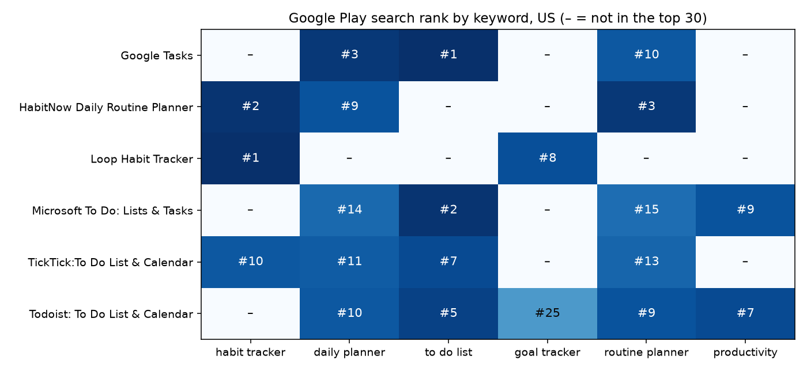

# How to Track Your App's Keyword Rankings on Google Play, in Any Country

*Where does your app rank on Google Play for "habit tracker" in the US, the UK and India, and who ranks above it? Here is how to check any app for any keyword and country, see what the apps above you have in common, and keep a daily ranking history, with Python or without code.*

*This guide was written with the assistance of an AI writing tool. Every code sample in it was run against the live scraper before publishing, and every number comes from those runs on October 21, 2026.*

App store optimization (ASO) starts with one question: when people search for what my app does, where does it show up? Google Play Console tells you how many people found your app through each search term, but not where you rank for a keyword, and nothing at all about the apps ranked above you. Search results also differ by country, so checking by hand on your own phone shows you one market at a time.

The [Google Play Scraper](https://apify.com/robertosan16/google-play-scraper) on Apify searches Google Play the way a user does, for any keywords and countries, and returns the results in order: rank, app, developer, rating, ratings count, installs, price, last update and more. No browser, no API key.

## Option 1: No code

1. Open [Google Play Scraper](https://apify.com/robertosan16/google-play-scraper) and click **Try for free**. The free Apify plan is enough for everything in this guide.
2. In **Search keywords**, enter the words your users type, one per line.
3. In **Countries**, add the markets you care about, such as `US`, `GB` and `IN`.
4. Click **Start**. Each search returns up to 30 apps with their rank. Download the results as CSV, Excel or JSON, and filter by your app.

## Option 2: Python, one app across 6 keywords and 3 countries

Install the Apify client and pandas:

```bash
pip install apify-client pandas matplotlib
```

Copy your API token from Apify Console (Settings → API & Integrations) into the `APIFY_TOKEN` environment variable. This script searches six keywords in the United States, the United Kingdom and India and shows where one app ranks. The example is HabitNow, a habit tracker with over 5 million installs; put your own app's ID (the `id=` part of its Play Store link) in `my_app`.

```python
import os
import pandas as pd
from apify_client import ApifyClient
client = ApifyClient(os.environ["APIFY_TOKEN"])
keywords = ["habit tracker", "daily planner", "to do list", "goal tracker", "routine planner", "productivity"]
run = client.actor("robertosan16/google-play-scraper").call(run_input={
    "searchTerms": keywords,
    "countries": ["US", "GB", "IN"],
}, logger=None)
df = pd.DataFrame(client.dataset(run.default_dataset_id).iterate_items())
df.to_json("rankings.json", orient="records")
my_app = "com.habitnow"
ranks = df[df["appId"] == my_app].pivot_table(index="searchTerm", columns="country", values="rank", aggfunc="min")
print(ranks.reindex(keywords).map(lambda r: "-" if pd.isna(r) else int(r)).to_string())
```

The run took about two minutes and returned 522 apps for 18 searches. The output:

```
country         GB  IN US
searchTerm               
habit tracker    2   4  2
daily planner    7  15  9
to do list       -  24  -
goal tracker     -   -  -
routine planner  2   3  3
productivity     -   -  -
```

In a few seconds of reading you can see where the app is strong and where it is invisible. HabitNow is in the top 4 for "habit tracker" and "routine planner" in all three countries. It is top 10 for "daily planner" in the US and the UK, but 15th in India. And it doesn't appear in the top 30 for "goal tracker" or "productivity" anywhere, or for "to do list" outside India. If those words describe your app too, they are the gaps to work on in your title, short description and full description.

## Who ranks above you

Every result comes with the app's details, so you can study the competition for a keyword. The top 10 for "habit tracker" in the US:

```python
import pandas as pd
df = pd.read_json("rankings.json")
top = df[(df["searchTerm"] == "habit tracker") & (df["country"] == "US")].sort_values("rank").head(10)
top["updated"] = pd.to_datetime(top["updatedAt"]).dt.date
top["ratingsCount"] = top["ratingsCount"].astype("Int64")
print(top[["rank", "title", "installs", "score", "ratingsCount", "updated"]].round({"score": 2}).to_string(index=False))
```

```
 rank                          title    installs  score  ratingsCount    updated
    1             Loop Habit Tracker  5,000,000+   4.72         63539 2025-09-14
    2 HabitNow Daily Routine Planner  5,000,000+   4.74         93308 2026-07-26
    3    Disciplined - Habit Tracker    500,000+   4.29         11573 2026-07-28
    4    Habitica: Gamify Your Tasks  5,000,000+   4.65         75955 2026-10-05
    5       Habit Tracker - HabitKit    500,000+   4.57         12042 2026-10-17
    6    Habit Tracker - HabitGenius    500,000+   4.43          8428 2026-10-05
    7    Habit Tracker - Habit Diary 10,000,000+   4.74        135861 2026-10-10
    8   Habit Tracker: Daily Routine     10,000+    NaN          <NA> 2026-09-21
    9 Habit Tracker & ToDo: HabitJar     10,000+   4.55           287 2026-08-29
   10 TickTick:To Do List & Calendar 10,000,000+   4.60        165841 2026-09-24
```

Three things stand out:

- **Size is not everything.** The app at #8 has 10,000+ installs and no ratings yet, and it ranks above TickTick, which has 10 million installs. Its title starts with the exact search term.
- **The keyword in the title matters.** All of the top 9 have "Habit" in their name, and seven contain the exact phrase "Habit Tracker". Only TickTick, at #10, has neither.
- **Freshness is not everything either.** Loop Habit Tracker, at #1, had its last update on September 14, 2025, more than a year before this run.

## The whole picture on one chart

To compare several apps across all keywords at once, draw the ranks as a grid:



```python
import matplotlib.pyplot as plt
import pandas as pd
df = pd.read_json("rankings.json")
us = df[df["country"] == "US"]
apps = ["com.habitnow", "com.todoist", "com.ticktick.task", "com.google.android.apps.tasks", "com.microsoft.todos", "org.isoron.uhabits"]
keywords = ["habit tracker", "daily planner", "to do list", "goal tracker", "routine planner", "productivity"]
grid = us[us["appId"].isin(apps)].pivot_table(index="title", columns="searchTerm", values="rank", aggfunc="min").reindex(columns=keywords)
fig, ax = plt.subplots(figsize=(10, 4.6))
ax.imshow(grid.fillna(60).values, cmap="Blues_r", vmin=1, vmax=60, aspect="auto")
for row, values in enumerate(grid.values):
    for col, value in enumerate(values):
        label, color = ("–", "#0b0b0b") if pd.isna(value) else (f"#{int(value)}", "white" if value <= 15 else "#0b0b0b")
        ax.text(col, row, label, ha="center", va="center", color=color, fontsize=11)
ax.set_xticks(range(len(keywords)), keywords)
ax.set_yticks(range(len(grid.index)), grid.index)
ax.set_title("Google Play search rank by keyword, US (– = not in the top 30)")
fig.tight_layout()
fig.savefig("ranks.png", dpi=140)
```

Each app owns a different set of words. Google Tasks is #1 for "to do list" and Microsoft To Do #2, but neither appears for "habit tracker". Loop and HabitNow lead "habit tracker" and are absent from "to do list". Todoist is the generalist: it ranks for five of the six keywords, without leading any of them.

## Keep a daily history

One run is a snapshot. Ranks move after updates, when a competitor changes its title, and during seasonal peaks, so it pays to record them every day. This snippet adds your app's ranks from the latest `rankings.json` to a CSV file and shows them by date; run it after each scrape:

```python
import os
import pandas as pd
df = pd.read_json("rankings.json")
today = pd.to_datetime(df["scrapedAt"]).dt.date.min()
mine = df[df["appId"] == "com.habitnow"][["searchTerm", "country", "rank"]].assign(date=str(today))
history_file = "rank_history.csv"
if os.path.exists(history_file):
    mine = pd.concat([pd.read_csv(history_file), mine]).drop_duplicates(["date", "searchTerm", "country"], keep="last")
mine.to_csv(history_file, index=False)
print(mine.pivot_table(index=["searchTerm", "country"], columns="date", values="rank").astype("Int64").to_string())
```

```
date                     2026-10-21
searchTerm      country            
daily planner   GB                7
                IN               15
                US                9
habit tracker   GB                2
                IN                4
                US                2
routine planner GB                2
                IN                3
                US                3
to do list      IN               24
```

Each new day adds a column. To do it without code, save your input as a **task** in Apify Console and add a **schedule**, for example every morning at 7:00, then send the results to Google Sheets from the task's **Integrations** tab.

## More you can do with the same Actor

- **Top charts**: top free, top paid and top grossing for any country and category, up to 200 places, with the same app details. Useful to watch a category, not just your keywords.
- **Developer catalogs**: every app of a competitor's developer account.
- **App details**: ratings histogram, exact install counts, version, release notes, in-app purchase range, ads, developer email and website.
- **Many countries in one run**: Google Play results differ by country, and each search is run for each country you add.

## What it costs

The Actor charges $0.50 per 1,000 results on the free Apify plan, with no start fee, and paid Apify plans get 10–30% off. The 18 searches above returned 522 apps, about $0.26. Tracking 6 keywords in 3 countries every day costs roughly $8 a month; the free plan's monthly credit covers about 10,000 results.
