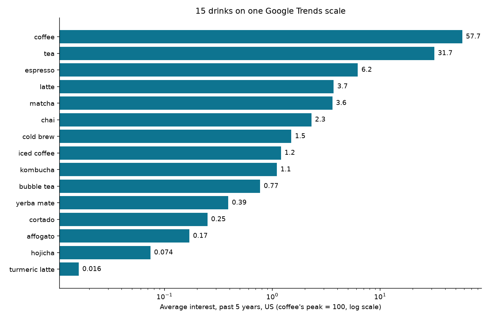
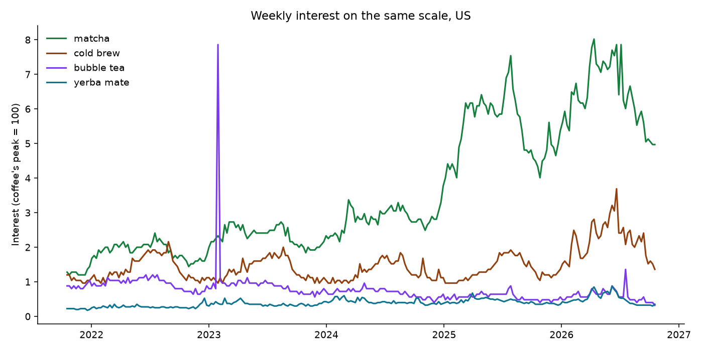

# How to Compare More Than 5 Keywords in Google Trends on One Scale

*Google Trends compares at most five search terms at a time, and every chart has its own scale. Here is how to put 15, 50 or 200 keywords on one 0–100 scale, check the result against Google's own numbers, and get decimals for small keywords instead of zeros, with Python or without code.*

*This guide was written with the assistance of an AI writing tool. Every code sample in it was run against the live scraper before publishing, and every number comes from those runs on October 20, 2026.*

Google Trends is the best free source of what people search for: how interest in a product, a brand or a topic rises and falls, which month it peaks, which regions care most. It has one limit that every marketer, SEO and analyst runs into sooner or later: you can compare at most five terms at once. Want to know where "hojicha" stands next to coffee, tea, matcha and eleven other drinks? Google Trends won't show you.

## Why you can't just make three charts

Google Trends never shows search volumes. Each chart is scaled so that its highest point is 100, and every other value is a share of that point. Compare "coffee" with four other drinks and coffee's best week is 100. Compare "hojicha" with four rare teas and hojicha's best week may be 100 as well. The two charts use different scales, so you cannot put them side by side.

There is a second problem. Google rounds every value to a whole number. Next to "coffee", a small keyword such as "hojicha" sits far below 1, so Google shows `0` week after week, or `<1` in the chart. The data is there, but the rounding hides it.

## The fix: compare everything through one shared keyword

The standard workaround uses an anchor: a keyword that appears in every group of five. Its real interest is the same in every request, so the ratio of its values tells you how to convert each group to the same scale.

Choosing the anchor matters. A tiny anchor gets rounded to zeros and makes the conversion useless. A huge anchor squeezes everything else to zeros. The approach used here avoids picking by hand:

1. **Find the biggest keyword.** Compare the keywords in groups of five, then compare the winners, until one keyword with the highest peak is left.
2. **Compare every other keyword next to it**, four at a time, and rescale each group by how the anchor came out in it. Because the anchor tops every group, the result is exactly what Google would show if it compared all your keywords at once.
3. **Refine the small keywords.** Keywords that came out as 0, 1 or 2 are compared again in groups led by a keyword only a little bigger than them, so Google measures them on a finer scale. They are then brought back to the shared scale through that leader's known values. Step by step, this reaches the smallest keywords, and they get decimals such as `0.074` instead of `0`.

You can do this by hand in the Google Trends website, but it takes dozens of comparisons and a spreadsheet. The [Google Trends Scraper](https://apify.com/robertosan16/google-trends-scraper) on Apify does it in one run when you turn on **Compare on one scale**. It has no limit on the number of keywords, takes several countries in one run, and adds ready insights to every keyword.

## Option 1: No code

1. Open [Google Trends Scraper](https://apify.com/robertosan16/google-trends-scraper) and click **Try for free**. The free Apify plan is enough for everything in this guide.
2. Enter your **keywords**, one per line, and your **locations**, such as `US` or `Germany`. Leave locations empty for worldwide.
3. Pick a **time range**, for example **Past 5 years**.
4. Turn on **Compare all keywords and locations on one scale**.
5. Click **Start**. The **Keyword insights** tab shows one row per keyword: average, peak, latest value, change, trend and best month. Download everything as CSV, Excel or JSON.

## Option 2: Python, 15 drinks on one scale

Install the Apify client, pandas and matplotlib:

```bash
pip install apify-client pandas matplotlib
```

Copy your API token from Apify Console (Settings → API & Integrations) into the `APIFY_TOKEN` environment variable. This script compares 15 drinks in the United States over the past five years:

```python
import os
import pandas as pd
from apify_client import ApifyClient
client = ApifyClient(os.environ["APIFY_TOKEN"])
drinks = ["coffee", "tea", "iced coffee", "espresso", "latte", "matcha", "cold brew", "chai",
          "bubble tea", "kombucha", "cortado", "yerba mate", "affogato", "hojicha", "turmeric latte"]
run = client.actor("robertosan16/google-trends-scraper").call(run_input={
    "keywords": drinks,
    "locations": ["US"],
    "timeRange": "today 5-y",
    "compareOnOneScale": True,
    "includeInterestByRegion": False,
    "includeRelatedQueries": False,
}, logger=None)
df = pd.DataFrame(client.dataset(run.default_dataset_id).iterate_items())
df.to_json("drinks.json", orient="records")
table = df[["keyword", "averageInterest", "peakInterest", "yearOverYearPercent", "trendDirection", "bestMonth"]]
print(table.sort_values("averageInterest", ascending=False).to_string(index=False))
```

The run took 32 seconds. The output:

```
       keyword  averageInterest  peakInterest  yearOverYearPercent trendDirection bestMonth
        coffee           57.700      100.0000               29.600         rising      July
           tea           31.700       45.0000               12.100         rising  December
      espresso            6.200       14.0000               36.200         rising  December
         latte            3.700        6.9000               32.700         rising September
        matcha            3.600        8.0200               21.600         rising     April
          chai            2.300        4.0100               17.700         rising September
     cold brew            1.500        3.6900               49.100         rising      June
   iced coffee            1.200        2.5000               47.300         rising      July
      kombucha            1.100        2.0500                2.100         stable     April
    bubble tea            0.770        7.8600               -0.033        falling  February
    yerba mate            0.390        0.8740                7.300         rising     April
       cortado            0.250        0.8990               -0.520         rising   January
      affogato            0.170        1.2200               11.900         rising    August
       hojicha            0.074        0.1740               34.100         rising      July
turmeric latte            0.016        0.0435               12.600         stable   January
```

All 15 drinks share one scale: coffee's best week is 100, and everything else is a share of it. Tea gets about half of coffee's interest, espresso a tenth, matcha one sixteenth. Hojicha averages 0.074, about one 780th of coffee. In Google's own comparison, it would be a row of zeros.

To draw the chart, add a few lines:

```python
import matplotlib.pyplot as plt
df = pd.read_json("drinks.json").sort_values("averageInterest")
fig, ax = plt.subplots(figsize=(10, 6.5))
ax.barh(df["keyword"], df["averageInterest"], color="#0e7490")
ax.set_xscale("log")
for y, value in enumerate(df["averageInterest"]):
    ax.text(value * 1.08, y, f"{value:g}", va="center", fontsize=10)
ax.set_xlabel("Average interest, past 5 years, US (coffee's peak = 100, log scale)")
ax.set_title("15 drinks on one Google Trends scale")
fig.tight_layout()
fig.savefig("drinks.png", dpi=140)
```



## Are these really Google's numbers?

A fair question: if a tool rescales Google's data, does the result still match Google? The Actor also accepts links copied from the Google Trends website and returns exactly what Google shows for them. So you can ask Google itself to compare five of the drinks and check them against the 15-drink run saved in `drinks.json`:

```python
import os
import pandas as pd
from apify_client import ApifyClient
client = ApifyClient(os.environ["APIFY_TOKEN"])
# The same five drinks, compared by Google itself on the Google Trends website.
link = "https://trends.google.com/trends/explore?date=today%205-y&geo=US&q=coffee,tea,espresso,yerba%20mate,hojicha"
run = client.actor("robertosan16/google-trends-scraper").call(run_input={
    "exploreUrls": [link],
    "includeInterestByRegion": False,
    "includeRelatedQueries": False,
}, logger=None)
google = pd.DataFrame(client.dataset(run.default_dataset_id).iterate_items()).set_index("keyword")
ours = pd.read_json("drinks.json").set_index("keyword")
for keyword in google.index:
    g = pd.Series([p["value"] for p in google.loc[keyword, "interestOverTime"]])
    o = pd.Series([p["value"] for p in ours.loc[keyword, "interestOverTime"]])
    print(f"{keyword:11} Google {g.mean():6.2f} (weeks {g.min()}-{g.max()})   "
          f"one scale {o.mean():7.3f}   largest weekly gap {(g - o).abs().max():.2f}")
```

The output:

```
coffee      Google  57.72 (weeks 45-100)   one scale  57.714   largest weekly gap 1.00
tea         Google  31.69 (weeks 26-45)   one scale  31.691   largest weekly gap 0.00
espresso    Google   6.21 (weeks 4-14)   one scale   6.210   largest weekly gap 1.00
yerba mate  Google   0.16 (weeks 0-1)   one scale   0.389   largest weekly gap 0.50
hojicha     Google   0.00 (weeks 0-0)   one scale   0.074   largest weekly gap 0.17
```

For the big drinks, the 15-drink scale equals Google's own comparison: the same averages to two decimals, single weeks within 1 point. That point of difference is Google's own noise: Trends is computed from a sample of searches, and the same request sent twice can differ by a point in single weeks.

For the small drinks, the numbers differ on purpose. Google gives yerba mate a 0 in most weeks and a 1 in a few, which averages 0.16. Its real level is about 0.39: Google rounds everything under 0.5 down to zero, so small keywords look smaller than they are, and very small ones disappear. Hojicha is zero in all 262 weeks on Google and 0.074 on the shared scale. If you rank niche products, ingredients or long-tail topics, this is the difference between "no data" and a usable number.

## What the weekly lines show

Every record also has the full weekly series, `interestOverTime`, on the same scale. Four of the drinks:



- **Matcha** more than tripled in five years, from about 1.3 to a peak of 8.0 in April 2026, and the insights mark it `rising` with a trend of +160%.
- **Cold brew** peaks every summer. Its best month is June, and its interest swings by 58% of its average across the year, against 10% for coffee itself.
- **Bubble tea** has one spike: the week of January 29, 2023, when Google celebrated it with an interactive Doodle. Its peak of 7.86 is ten times its average, which is why the average, not the peak, is the better number for ranking.
- **Yerba mate** sits below 1 for the whole period. On Google's own chart next to coffee, it would be a flat line at zero.

## Insights in every record

You don't need to compute any of this yourself. Each keyword comes with:

- `averageInterest`, `peakInterest` and `peakDate`
- `latestInterest` and `latestDate`: the last complete week; the current, unfinished week is marked `isPartial` and left out
- `recentChangePercent`: the last four weeks against the four before
- `yearOverYearPercent`: the last 12 months against the 12 months before
- `trendDirection` (`rising`, `stable` or `falling`) and `trendPercent`
- `bestMonth`, `worstMonth` and `seasonalityPercent`, from two years of data or more

With **Interest by region** and **Related queries** turned on, each record also lists the regions or cities with the most interest, and the top and rising related searches. Rising searches carry some bot traffic, such as "pet care tips" listed under "coffee", so every query is flagged `containsKeyword` and `looksLikeSpam` to make it easy to filter.

## Bonus: what is trending right now

The same Actor also returns the full **Trending now** list of a country: often 200 to 500 searches for the past 24 hours, each with an approximate search volume. One `curl` request is enough:

```bash
curl -X POST "https://api.apify.com/v2/acts/robertosan16~google-trends-scraper/run-sync-get-dataset-items?token=YOUR_API_TOKEN" \
  -H "Content-Type: application/json" \
  -d '{"trendingLocations":["US"],"trendingHours":"24","trendingCategories":["Food and Drink"],"maxTrendingPerLocation":3}'
```

It answered in 4 seconds with the three food searches trending in the United States that day. One of them, shortened:

```json
{
  "type": "trending",
  "location": "US",
  "rank": 8,
  "term": "gluten free ritz cracker launch",
  "searchVolume": 50000,
  "searchVolumeText": "50K+",
  "increasePercent": 1000,
  "isActive": true,
  "categories": ["Food and Drink"],
  "relatedSearches": ["ritz crackers gluten free", "gluten free ritz crackers"]
}
```

## What it costs

The Actor charges per result: $2 per 1,000 keyword reports (one keyword in one location, with its timeline, insights, regions and related queries) and $0.50 per 1,000 trending searches, with no start fee. The extra requests of the one-scale comparison are free. The 15-drink comparison above cost 15 reports, $0.03. The monthly credit of the free Apify plan covers about 2,500 keyword reports, and paid Apify plans get 10–30% off.

## Things to know

- **Interest, not volume.** Google Trends values are shares of the highest point, not numbers of searches. Trending now is the exception: Google gives an approximate volume such as `50K+`.
- **Samples change a little.** Google computes Trends from a sample of searches, so repeated runs can differ by a point in single weeks. Once in our tests, Google answered with a different sample in which coffee averaged 59.6 instead of 57.7. Compare keywords from the same run.
- **Shape or popularity?** With **Compare on one scale** off, every keyword gets its own 0–100 range, which shows the shape of its trend best. Turn it on when you want to rank keywords against each other.
- **Daily data.** Google gives days for ranges up to about nine months, weeks up to five years, and months beyond.

If you study demand, plan content or compare products, try the [Google Trends Scraper](https://apify.com/robertosan16/google-trends-scraper) with your own keywords. Missing a field or a feature? Write to support@mozartstandard.com.
